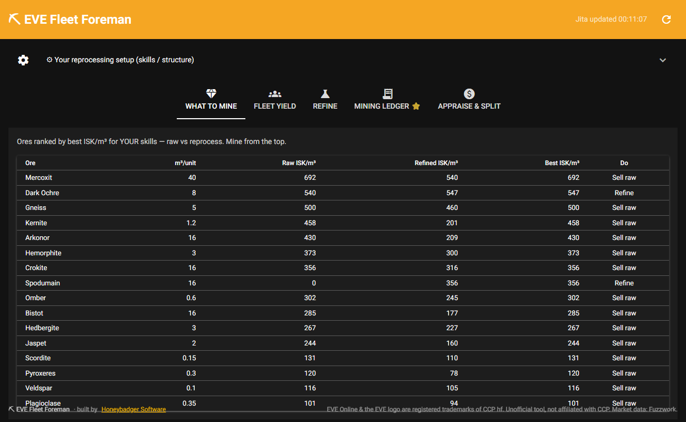
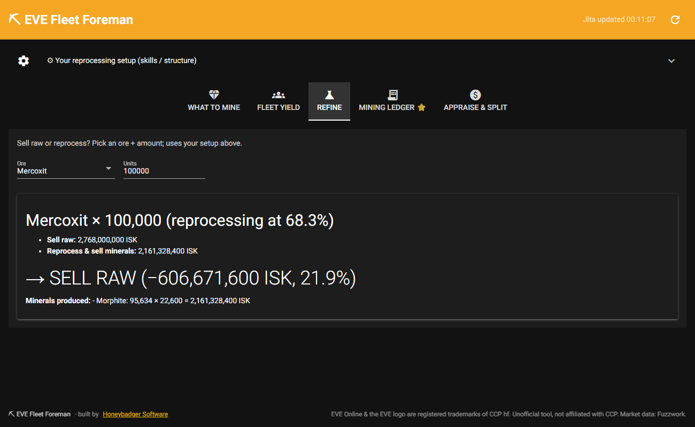
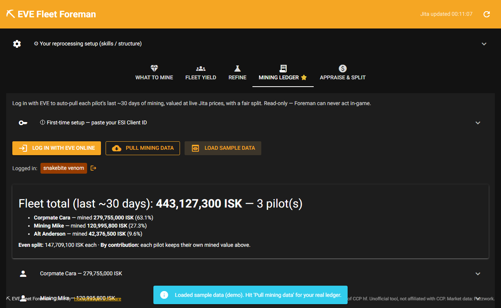

# ⛏ EVE Fleet Foreman

*A free, open-source tool by [Honeybadger Software](https://honeybadger.software).*

**A free fleet-mining assistant for EVE Online.** It answers the questions that
actually make mining pay — *what should I mine right now?*, *should I refine or
sell?*, *what's my fleet making?*, and *how do we split the ore fairly?* — using
live Jita market data and your own Mining Ledger.

> **100% EULA-safe.** Foreman never touches the game client. No memory reading,
> no input automation, no input broadcasting. It only reads **public market data**
> and (if you log in) your **own read-only Mining Ledger** from CCP's official API.
> Multiboxing is allowed; the bannable stuff is input broadcasting and botting —
> Foreman does **none** of that.

---

## ✨ What it does

| Tab | What you get |
|-----|--------------|
| **What to Mine** | Every ore ranked by **ISK per m³** from live Jita prices — raw vs reprocessed, for *your* refining skills. Mine from the top down. |
| **Fleet Yield** | Enter your ships (barges, exhumers, + an Orca/Porpoise boost) → combined **m³/min, ISK/hour, time-to-fill, hauler trips**. |
| **Refine** | Pick an ore + amount → a clear **"SELL RAW vs REFINE"** verdict with the full mineral breakdown. Uses real reprocessing yields from CCP's data. |
| **Mining Ledger** ⭐ | Log in with EVE → auto-pull each pilot's last ~30 days of mining, valued at live prices, with an **even / by-contribution split**. The fair-payout problem, solved. |
| **Appraise & Split** | Paste a pile of ore → total ISK + a fair per-member split. No login needed. |

---

## 📸 Screenshots

**What to Mine** — every ore ranked by ISK/m³ (raw vs refined) from live Jita prices:



**Refine** — an instant "sell raw vs reprocess" verdict with the full mineral breakdown:



**Mining Ledger** — log in with EVE and auto-split the fleet's mining fairly:



## 🚀 Install & run

**You need [Python 3.10+](https://www.python.org/downloads/)** (tick *"Add Python to PATH"* during install).

1. **Download** this project (green **Code → Download ZIP**, then unzip) — or `git clone`.
2. Open a terminal in the folder and install the two dependencies:
   ```
   pip install -r requirements.txt
   ```
3. **Start it:**
   - Windows: double-click **`run_eve_foreman.bat`**
   - Any OS: `python app.py`
4. Your browser opens **http://localhost:8088**. That's it.

*(A one-click Windows installer — no Python needed — is on the roadmap.)*

---

## 🔑 Connect your EVE account (for the Mining Ledger tab)

The first four tabs work with no login. The **Mining Ledger** needs a quick,
**free, one-time** connection so EVE will let Foreman read *your* mining data.

You log in on **CCP's own page** — Foreman never sees your password, only a
token you can revoke any time. It uses **PKCE**, so there's no secret to manage.

**If this build came with a Client ID bundled:** just open the **Mining Ledger** tab
and click **Log in with EVE Online**. Done.

**Otherwise, register your own free app once (≈3 minutes):**
1. Go to **https://developers.eveonline.com** → log in → **Manage Applications** → **Create New Application**.
2. **Name:** anything (e.g. `My Fleet Foreman`). **Description:** anything.
3. **Callback URL:** `http://localhost:8088/callback` *(exact)*
4. **Scopes:** add **`esi-industry.read_character_mining.v1`** (and `esi-industry.read_corporation_mining.v1` for corp mode later).
5. **Create**, then copy the **Client ID** (ignore the Secret — not needed).
6. In Foreman → **Mining Ledger** tab → **① First-time setup** → paste the Client ID → **Save**.

Then: **Log in with EVE Online** → **Authorize** → **Pull mining data**. 🎉

> **Heads-up:** CCP's Mining Ledger updates only about **once a day**, and only
> covers the last ~30 days. If it comes back empty, you simply haven't mined
> recently — it's not a bug. Use **Load sample data** to see the layout.

---

## 📖 How to use each tab

- **What to Mine** — Open the **⚙ reprocessing setup** bar and set your base station
  yield % and skills once; the table then shows the best ore *for you*, comparing
  selling raw against reprocessing. Higher "Best ISK/m³" = more value per cargo trip.
- **Fleet Yield** — Type how many of each ship are in the fleet. The defaults are
  mid-skill ballparks — tune the yield/hold numbers to your fit. Tick **Fleet boost**
  if an Orca/Porpoise is running mining bursts.
- **Refine** — Pick an ore and a quantity to see exactly how much ISK you'd get
  selling it raw vs reprocessing it into minerals at your efficiency.
- **Mining Ledger** — After login, **Pull mining data**. Add as many characters as
  you like (log in again for each). The split shows both an even split and each
  pilot's own contribution.
- **Appraise & Split** — Paste lines like `Veldspar 250000`. Choose buy or sell
  value and how many fleet members to split between.

---

## 🔒 Privacy & safety

- Foreman runs **entirely on your computer**. Nothing is sent anywhere except read
  requests to CCP's official API and public market data.
- Your login token is stored locally in `tokens.json` (git-ignored, never shared).
- The access is **read-only** — Foreman literally cannot undock, trade, or change
  anything in-game. Revoke access any time at <https://community.eveonline.com/support/third-party-applications/>.

---

## 🐞 Found a bug? Want a feature?

This is an early free release — **please open a GitHub Issue!** Tell me what you
did, what you expected, and what happened (paste any error text). Mining-fleet
feedback especially welcome.

---

## 🗺️ Roadmap

- One-click **Windows installer** (no Python needed)
- **Deluxe version:** an always-on-top **mining HUD overlay** that floats over your
  game, corp/structure ledger mode, profit history graphs, price alerts, ice & moon
  ore, and compression math.

---

## 👋 Built by Honeybadger Software

EVE Fleet Foreman is built and maintained by **[Honeybadger Software](https://honeybadger.software)**
— an independent software studio shipping practical, well-engineered tools across
gaming, automotive, and industrial/hardware automation. This is real, supported
software, not a throwaway script.

- 🌐 More projects & contact: **[honeybadger.software](https://honeybadger.software)**
- 💬 Got an idea, a bug, or want something custom built? Reach out via the site, or open an Issue here.

If Foreman saves your fleet some time, a ⭐ on the repo — and a share with your corp — really helps.

## 🙏 Credits & legal

- Ore/type data & Mining Ledger: **CCP ESI** (`esi.evetech.net`)
- Market prices: **Fuzzwork** (`market.fuzzwork.co.uk`)
- Built by **Honeybadger Software** · [honeybadger.software](https://honeybadger.software)

> EVE Online and the EVE logo are the registered trademarks of CCP hf. All rights
> reserved worldwide. This is an unofficial, fan-made tool and is **not affiliated
> with or endorsed by CCP hf.** All EVE-related materials are property of CCP hf.

Released under the **MIT License** — see [LICENSE](LICENSE).
